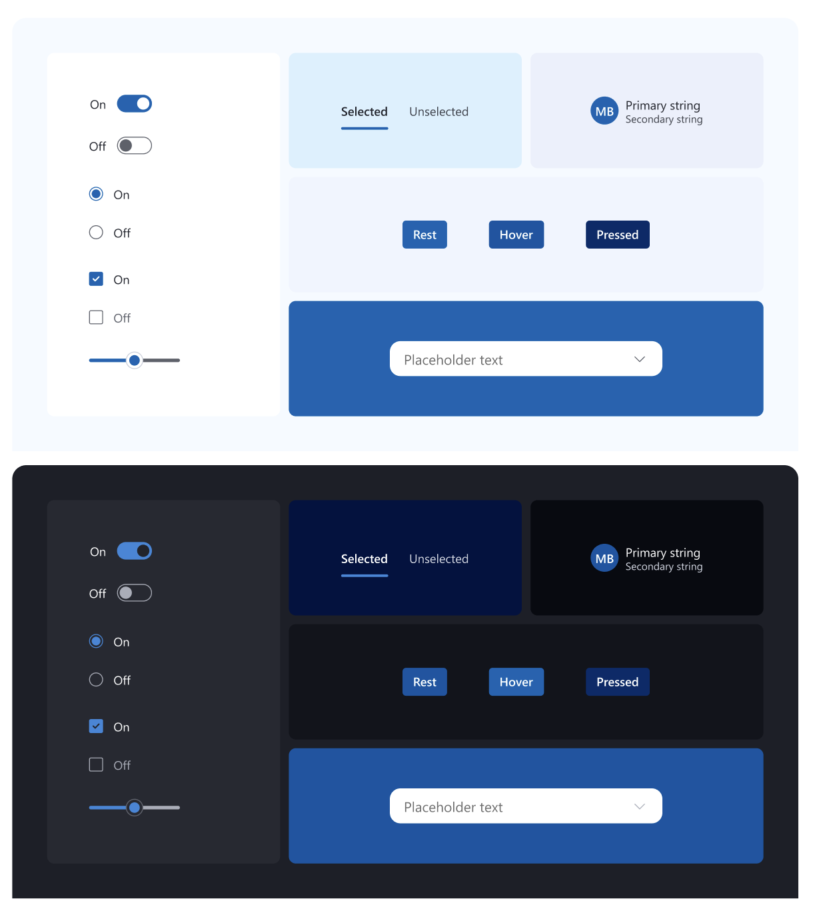
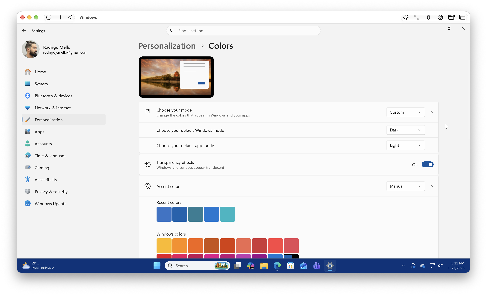
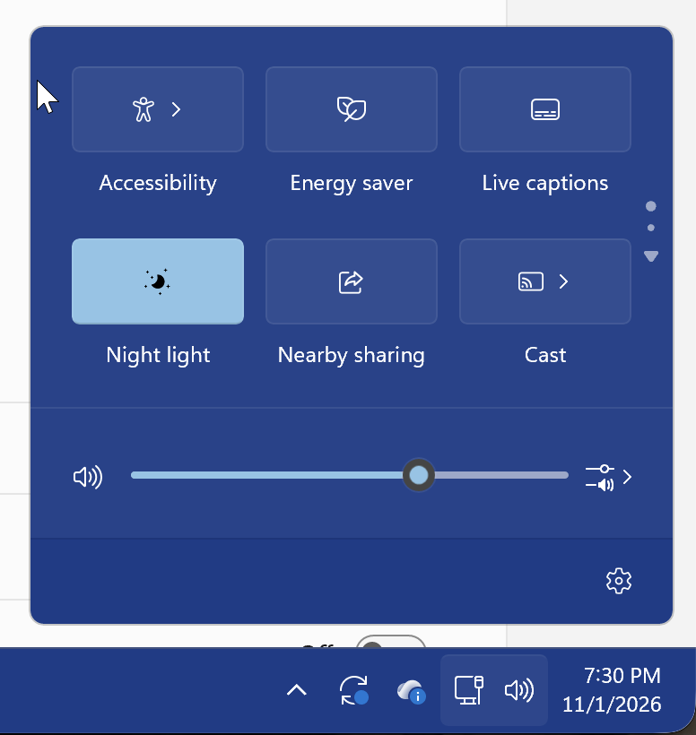
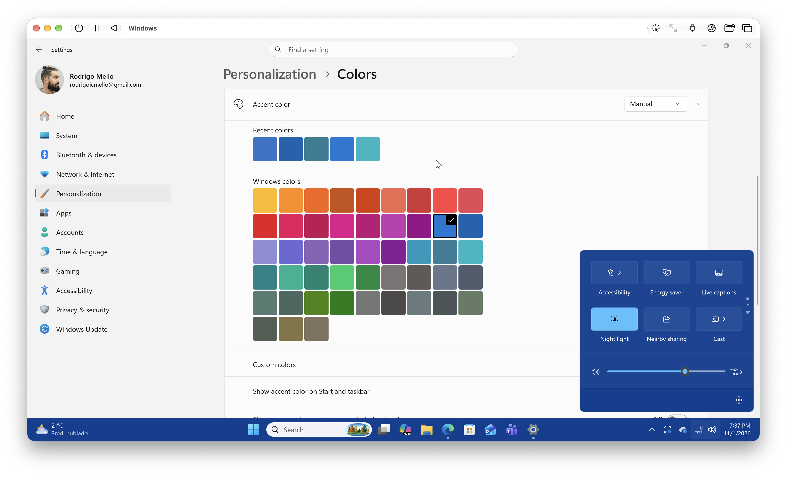
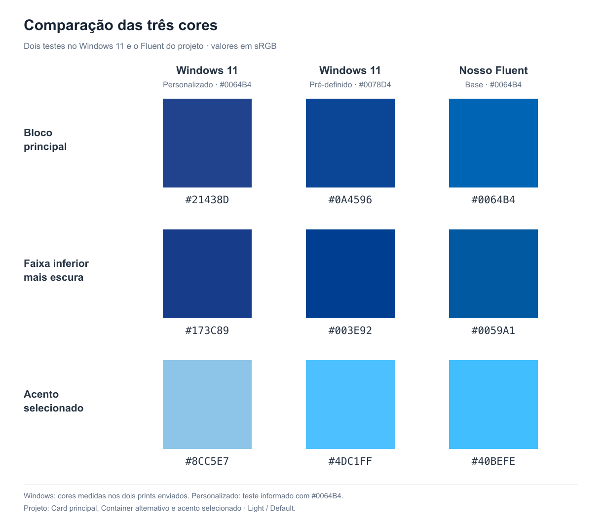
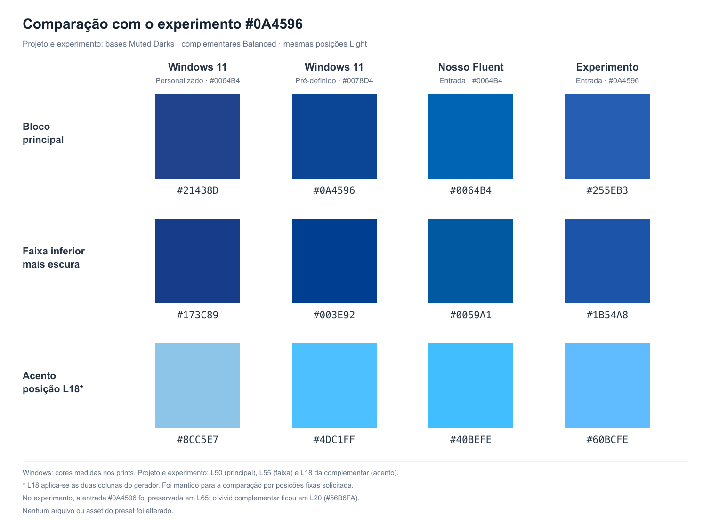

# Fluent Theme And Surface Context Decision

Status: **Kiskadee extension**, approved by the user on 2026-11-01. Keep the current Fluent
palette and the independent theme/context recipes. This decision records the evidence and the
limits of the Windows comparison; it does not promote another tonal asset or change a formula.

The shared decision is [Theme and Surface Context](../../../../../../docs/definitions/theme-and-surface-context.md#theme-and-surface-context),
with React transport defined by [Surface Context](../../../../../components/react/docs/definitions/surface-context.md).
This document owns the Fluent-specific rationale, not a new cross-preset theme rule.

## Decision

`onVivid` describes the surface consumed by a component. It does not select the Dark theme.
Light/onVivid and Dark/onVivid remain separate authored combinations, including their interaction,
foreground and contrast recipes. A vivid region does not implicitly switch its descendants to Dark.

The current Light blue surface and generated complementary accent are acceptable to the user.
Retain the approved [Muted Darks and complementary promotion](fluent-tonal-scale-evidence.md#muted-darks-and-complementary-promotion)
and the existing Container/Card pair. Do not darken every Light/onVivid surface to reproduce the
Windows Quick Settings captures, merge its formulas with Dark, or recalibrate the generator from
this comparison.

Identical colors or formulas remain permissible when a preset deliberately authors them. The axes
are independent responsibilities, not a requirement that every combination look different.

## Sources And Coverage

| Source area | Reference and inspected scope | Status | Boundary |
| --- | --- | --- | --- |
| Figma theme composition | File `qdtPPQysSX0kHGGcDpEXzw`, node `9738:4925`; user-supplied raster with Light and Dark compositions | Official exact | The flat blue regions can be sampled; the raster does not expose their own variable bindings. |
| Figma theme aliases | The same file's `Mode` collection, Light `8936:71` and Dark `8936:72`; `Brand/Background/1/Rest` and Brand ramp | Official exact | Alias inspection independently resolves Light Brand80 and Dark Brand70. |
| Fluent Web brand roles | Public color-token documentation and `@fluentui/tokens` Light/Dark aliases | Official exact | Web's current Brand ramp differs from the project's Figma ramp. |
| WinUI accent materials and fills | Accent Acrylic and AccentFill resources in the official WinUI source | Official exact | Resource roles explain a possible dark-surface/light-accent relationship; they do not identify the private Quick Settings brush binding. |
| Windows Quick Settings and personalization | User captures, selected accent swatches, and Custom Windows Dark / apps Light settings | Official adapted | Pixel colors describe these captures, including material composition, not universal Microsoft token values. |
| Current Kiskadee surfaces and companions | Existing preset assets, strict locators and the three-component complementary pilot | Kiskadee extension | Approved approximation; no claim of Microsoft's accent derivation algorithm. |
| Exact Windows Shell implementation | Brush selection and compositing behind these Quick Settings captures | Not inspected | No exact Shell-to-Web-token equivalence is asserted. |

Primary references:

- [Figma Light/Dark composition](https://www.figma.com/design/qdtPPQysSX0kHGGcDpEXzw/Microsoft-Fluent-2-Web--Community-?node-id=9738-4925)
  and [Brand ramp](https://www.figma.com/design/qdtPPQysSX0kHGGcDpEXzw/Microsoft-Fluent-2-Web--Community-?node-id=9738-4937).
- [Fluent color guidance](https://fluent2.microsoft.design/color/) and
  [color tokens](https://fluent2.microsoft.design/color-tokens/).
- Fluent Web [Light aliases](https://github.com/microsoft/fluentui/blob/master/packages/tokens/src/alias/lightColor.ts),
  [Dark aliases](https://github.com/microsoft/fluentui/blob/master/packages/tokens/src/alias/darkColor.ts),
  and [current Brand ramps](https://github.com/microsoft/fluentui/blob/master/packages/tokens/src/global/brandColors.ts).
- WinUI [Acrylic theme resources](https://github.com/microsoft/microsoft-ui-xaml/blob/main/controls/dev/Materials/Acrylic/AcrylicBrush_themeresources.xaml)
  and [common theme resources](https://github.com/microsoft/microsoft-ui-xaml/blob/main/controls/dev/CommonStyles/Common_themeresources_any.xaml).
- Microsoft [accent palette](https://learn.microsoft.com/en-us/windows/apps/develop/ui/theming#accent-color-palette),
  [Windows color personalization](https://support.microsoft.com/en-us/windows/experience/personalization/personalize-your-colors-in-windows),
  [Acrylic material](https://learn.microsoft.com/en-us/windows/apps/design/style/acrylic), and
  [local RequestedTheme](https://learn.microsoft.com/en-us/uwp/api/windows.ui.xaml.frameworkelement.requestedtheme)
  documentation.

## Figma: Blue Surfaces In Both Themes

The supplied composition contains a vivid blue region in both its Light and Dark examples.
Those regions are not the same blue:

| Inspected theme | Figma `Brand/Background/1/Rest` | Flat region in the supplied image |
| --- | --- | --- |
| Light | Brand80 `#0064B4` | `#0064B4` |
| Dark | Brand70 `#0055A4` | `#0055A4` |

The original 1232 x 1370 sRGB PNG was sampled in two flat 60 x 30 px patches: Light at `(480, 475)`
and Dark at `(480, 1145)`. Each patch contained 1,800 pixels of its respective value. Independent
`Mode` alias inspection agrees with those samples. The tool could not inspect the raster's own
binding at node `9738:4925` because of a plan limit; agreement is not presented as that binding.

The current Kiskadee Light main surface is `#0064B4`, matching the Light composition's blue.
That is positive source evidence for retaining it. The darker Figma blue also supports retaining
a separate Dark recipe. It does not establish that all onVivid regions must use one dark blue.

The public Web aliases reinforce the distinction between a theme-relative role and a static one:
`colorBrandBackground` selects Brand80 in Light and Brand70 in Dark, while
`colorBrandBackground3Static` and `colorBrandBackground4Static` select Brand60 and Brand40 in both.
`colorBrandBackgroundInverted` is white, not a role for the dark blue panel. The current Web ramp
has Brand80 `#0F6CBD`, Brand60 `#0F548C` and Brand40 `#0C3B5E`; those HEX values must not be mixed
with the project's Figma Brand ramp as if they were one palette.

The official [Fluent color guidance](https://fluent2.microsoft.design/color/) also distinguishes
platform interaction treatments: Web generally darkens colors on interaction, while Windows
currently lightens them. A platform difference is not, by itself, proof of outdated documentation.

## Windows: A Dark Shell Beside Light Apps

The user's configuration is **Custom**, with **default Windows mode Dark** and **default app mode
Light**. A white Settings app beside a dark taskbar/Quick Settings panel therefore does not prove
that the panel belongs to a Light theme. It is evidence of a mixed-theme composition.

Official personalization guidance makes the Windows/app distinction and restricts the Start/taskbar
accent option to Dark or Custom Windows mode. WinUI also publishes separate accent material
recipes: Default/dark Accent Acrylic resources use `SystemAccentColorDark1` or `Dark2`, whereas
their Light counterparts use `SystemAccentColorLight3`. The inspected dark AccentFill default uses
`SystemAccentColorLight2`, with dark content. The system generates light and dark shades from the
accent color. These are source-backed examples of darker material and brighter active control
roles, not proof that Quick Settings uses a particular Web alias or a literal sampled HEX.

Acrylic combines tint, luminosity, transparency, blur and other material inputs. A screenshot's
final pixel need not equal its generating accent or one primitive token. Changing the accent can
also change its resulting material palette. The two captures below consequently remain separate
observations, not two measurements of a single invariant Windows blue.

Neither this evidence nor Fluent Web's darker static roles requires an opaque Light/onVivid
Kiskadee Card to become a dark Acrylic panel. A local Dark + onVivid region inside a Light
application can represent that kind of composition through the existing theme/context axes.
It is not a promise of an exact Windows match: that requires its own accepted Dark calibration,
materials and component coverage, which remain outside this decision.

## Palette Comparison And Generator Experiment

The following flat-region HEX values identify the preserved comparison. Windows values are
capture samples, not official token assignments. Kiskadee values identify the current Default/Light
composition and the unpromoted generator experiment.

| Observation | Main region | Darker companion region | Active accent |
| --- | --- | --- | --- |
| Windows custom test, input reported as `#0064B4` | `#21438D` | `#173C89` | `#8CC5E7` |
| Windows predefined accent swatch `#0078D4` | `#0A4596` | `#003E92` | `#4DC1FF` |
| Current Kiskadee Fluent | L50 `#0064B4` | L55 `#0059A1` | Complementary L18 `#40BEFE` |
| Unpromoted `#0A4596` experiment, same fixed positions | L50 `#255EB3` | L55 `#1B54A8` | Complementary L18 `#60BCFE` |

The first Windows accent is less saturated than the second. It helped establish that a softer
complementary accent is plausible in a real Windows composition. The user accepted the current
Kiskadee variation as coherent within its scale; exact screenshot matching is not the acceptance
criterion. Perceived accent prominence also depends on the surrounding blue, not just accent
saturation. A darker main region may strengthen the same accent without requiring another seed.
That observation motivated investigation; it did not authorize changing the main surface.

The fourth column deliberately holds positions constant for comparison. It is not the appearance
the existing functional recipe would automatically consume with the new input. In that experiment,
the base input lands at L65 `#0A4596`, while the generated complementary seed and its `vivid`
reference land at L20 `#56B6FA`. Current components consume their published functional references,
not an unconditional L18. The fixed-position comparison neither promotes those experimental values
nor proves that every generating input behaves identically.

## Preset Mapping And Preservation Boundary

The current main region is the Container-owned `primary.highest` Rest fill, incorporated into Card
at build time. `primaryComplementary.highest` is the darker companion region from the same base
Primary tonal family. The word "companion" here names a surface role; it is distinct from the
generator-derived `.c` color family used by active controls.

The existing [Container calibration](../components/container.md) and
[Card mapping](../components/card.md) retain those ownership boundaries. The approved generated
companion families remain independently traceable in the [promotion evidence](fluent-tonal-scale-evidence.md#muted-darks-and-complementary-promotion).
Button, Switch and Slider consume them only in their documented pilot recipes:

- [Button Primary Medium Pressed/Selected](../components/button.md#complementary-primary-medium-on-vivid--2026-11-01).
- [Switch active Neutral](../components/switch.md#complementary-accent-pilot-2026-11-01).
- [Slider active Neutral](../components/slider.md#complementary-accent-pilot-2026-11-01).

This decision preserves base assets, functional anchors, strict locators, theme/context formulas,
component scopes and documented runtime limitations. A theme switch is not a color-source
migration, and a Surface Context switch is not a theme switch. Other design systems can organize
local themes and contextual colors differently; the explicit Kiskadee axes do not imply that
other platforms lack those capabilities.

## Validation And Deferred Work

- Evidence review compared the supplied sRGB captures, the live Figma `Mode` aliases and the
  official Web/WinUI roles described above. Pixel samples and role interpretation remain separate.
- Documentation-only validation checks local references and whitespace. No application behavior,
  generated artifact, CSS, preset palette or component recipe changes in this decision.
- **Deferred:** a separately scoped calibration of Dark/onVivid against Windows-like compositions,
  if requested. The present record does not establish exact Shell brush bindings or require a
  later Dark formula to equal Light.
- **Not inspected:** a complete cross-component visual matrix after this decision. Later component
  reviews may identify concrete contrast or legibility issues without reopening the independence
  of Theme and Surface Context or assuming that every screenshot difference is stale documentation.
